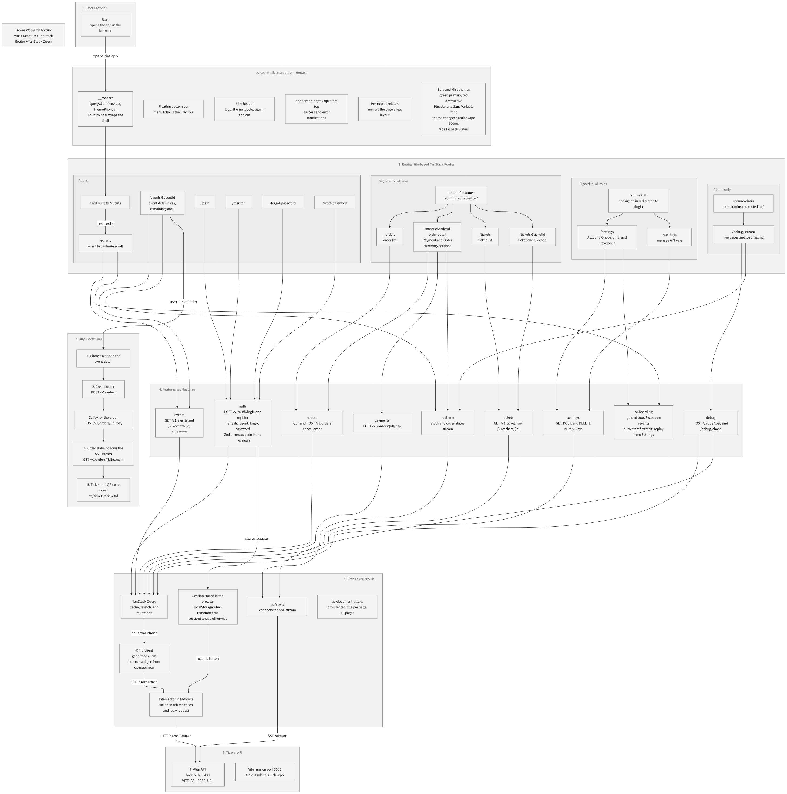

# TixWar Web

Flash-sale ticketing frontend for the TixWar API (`../api`).

Users browse events, reserve ticket tiers inside their sale windows, pay or cancel orders, and
view issued tickets with QR codes. API-key management is available to signed-in users; admins
also get a debug dashboard with load generation, chaos injection, and a live trace stream.

## Architecture



Architecture diagram source (Mermaid): [`docs/tixwar-web-architecture.mmd`](docs/tixwar-web-architecture.mmd).

## Minimum Specs

Figures below are **estimates** for local development, not measured numbers: the repo ships no
Dockerfile and no resource limits, so they are reasoned from the stack, not benchmarked.

| Setup  | CPU    | RAM  | Disk |
| ------ | ------ | ---- | ---- |
| Docker | 1 vCPU | 1 GB | 2 GB |
| Podman | 1 vCPU | 1 GB | 2 GB |
| Native | 1 vCPU | 1 GB | 2 GB |

- **Docker** — no Dockerfile is shipped. Build the production output (`bun run build` → `dist/`) into an image and serve it with nginx or `vite preview`. The web needs a reachable API: set `VITE_API_BASE_URL` and make sure the API's `CORS_ORIGINS` includes the web origin.
- **Podman** — same as Docker. In this project's VM, rootful Podman with `--network host` is the setup that works; rootless Podman did not.
- **Native** — Bun `>= 1.3`. `bun run dev` serves on port 3000. Requires a running TixWar API (default `http://localhost:8080`) with CORS allowing the web origin; see Prerequisites.

## Stack

- Vite + React 19 + TypeScript (strict)
- TanStack Router (file-based routes, generated route tree)
- TanStack Query (shared query client, SSE-driven invalidation)
- Tailwind CSS v4 + shadcn/ui (CSS variables, light/dark themes)
- Biome for lint + format
- Bun for package management, scripts, and the type-sync script
- `@hey-api/openapi-ts` generated client and types from the API OpenAPI document

## Prerequisites

- [Bun](https://bun.sh) `>= 1.3`
- A running TixWar API. Default base URL is `http://localhost:8080`.
- The API CORS list must include the web dev origin, e.g.
  `CORS_ORIGINS=http://localhost:3000,http://localhost:8080` in `../api/.env`.
- A sibling checkout at `../api` only when regenerating the client/types.

## Quickstart

```bash
cp .env.example .env   # VITE_API_BASE_URL=http://localhost:8080
bun install
bun run dev            # http://localhost:3000
```

Start the API and seed data first; see `../api/README.md`. The event list is the landing screen.

## Environment

| Variable            | Default                 | Purpose                                                        |
| ------------------- | ----------------------- | -------------------------------------------------------------- |
| `VITE_API_BASE_URL` | `http://localhost:8080` | Base URL for every generated-client request (`src/lib/api.ts`) |

`.env` is git-ignored. Use `.env.example` as the template and never commit secrets.

## Commands

| Command             | Action                                                                      |
| ------------------- | --------------------------------------------------------------------------- |
| `bun run dev`       | Vite dev server on port 3000                                                |
| `bun run build`     | Type-check project references, then build to `dist/`                        |
| `bun run preview`   | Serve the production build locally                                          |
| `bun run lint`      | `biome check .` (format + lint)                                             |
| `bun run typecheck` | `tsc -b --noEmit`                                                           |
| `bun run api:gen`   | Regenerate `src/lib/client/**` and copy `docs/api-types.d.ts` from `../api` |

Run `lint`, `typecheck`, and `build` before every commit. Do not proceed if any is red.

`api:gen` reads `../api/docs/openapi.json` and `../api/docs/api-types.d.ts`. In the API repo, run
`just api-types` first so both artifacts exist.

## Routes

| Route                | Access        | Screen                                                        |
| -------------------- | ------------- | ------------------------------------------------------------- |
| `/`                  | public        | Redirects to `/events`                                        |
| `/events`            | public        | Searchable, filterable, paginated event list                  |
| `/events/$eventId`   | public        | Event detail, live stock stats, tier purchase                 |
| `/login`             | public        | Login, honors `?redirect=`                                    |
| `/register`          | public        | Account creation                                              |
| `/orders`            | authenticated | Order list filtered by status                                 |
| `/orders/$orderId`   | authenticated | Order detail, countdown, pay/retry/cancel, live status stream |
| `/tickets`           | authenticated | Issued tickets                                                |
| `/tickets/$ticketId` | authenticated | Ticket QR, download                                           |
| `/api-keys`          | authenticated | Create, copy-once, list, revoke API keys                      |
| `/debug/stream`      | admin only    | Load generator, chaos injection, live trace feed              |

`requireAuth` redirects unauthenticated users to `/login?redirect=<current URL>`; `requireAdmin`
also requires `session.user.role === 'admin'`.

## API and auth behavior

`src/lib/api.ts` configures the single generated client at startup (imported by `main.tsx`):

- Sends `Authorization: Bearer <accessToken>` for bearer auth.
- On `401`, refreshes once with a single-flight promise, retries the request, and clears the
  session if refresh fails. Auth endpoints themselves are excluded from this retry.
- On `429`, copies `Retry-After` into `ApiError.retryAfterSeconds`; `ErrorState` renders it.
- Normalizes every failure to `ApiError` (`src/lib/errors.ts`) with problem details,
  domain `code`, `requestId`, and field `errors`.
- Session lives in `localStorage` under `tixwar.session`; theme under `tixwar.theme`.

Order creation and payment attach a fresh `Idempotency-Key` header. TanStack Query retries twice,
except `401`/`403`/`404`, `SOLD_OUT`, and `ORDER_EXPIRED`; `429` gets up to two attempts. Queries
are stale after 30 seconds.

Realtime hooks (`src/lib/sse.ts`) use generated SSE endpoints:

- `useStockStream` invalidates event and event-stats queries on `stock.released`.
- `useOrderStream` patches order status from `order.status`, then invalidates orders and tickets.
- `useDebugStream` feeds admin traces.

Aborts and connection resets are ignored because the generated client reconnects. Streams are
disabled on unmount.

## Project layout

```
src/
  components/ui/     shadcn primitives
  components/        shared presentational components; status.tsx owns loading/empty/error
  features/<name>/   feature queries, mutations, hooks, forms
  routes/            file-based TanStack Router routes
  lib/               generated client, client config, auth, errors, SSE, query client, helpers
docs/api-types.d.ts  generated API types shared with the API repository
scripts/sync-types.ts
```

Use the `@/` alias for `src/` and `@api-types` for `docs/api-types`.

## Conventions

- Call the generated client (`@/lib/client`) for every API request. Never write manual `fetch`.
  The only exception is downloading a ticket QR image blob in the ticket detail route.
- Never invent endpoints; only call functions generated from the API document.
- Domain types come from `@api-types`, e.g. `components['schemas']['Order']`.
- Every feature screen renders loading (skeleton), empty, and error states via
  `src/components/status.tsx`.
- Mobile-first, keyboard navigable, ARIA labels on icon controls. Respect
  `prefers-reduced-motion` for non-essential animation.
- No decorative section-separator comments; comment only non-obvious logic.

## Generated files

`src/lib/client/**` and `src/routeTree.gen.ts` are generated. Do not hand-edit them. The route
tree is generated by the TanStack Router Vite plugin; the client and `docs/api-types.d.ts` come
from `bun run api:gen`.
